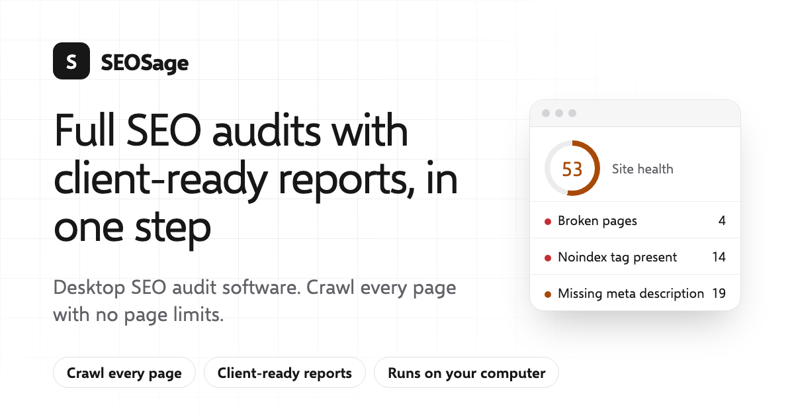

<p align="center">
  <a href="https://seosage.co"></a>
</p>

**SEOSage is desktop SEO audit software for Mac and Windows.** It crawls every page of a website on your own computer, with no page limits, explains what is wrong and how to fix it, and turns the results into client-ready reports with your own logo.

- **Every page, no limits:** crawl live sites, staging sites and password-protected sites
- **Fix and re-check:** confirm a fix worked without crawling the whole site again
- **White-label reports:** PowerPoint, PDF, Excel and CSV with your brand
- **Your data stays local:** crawls run and stay on your computer
- **Works with Claude:** ask about your crawl in plain English, or build a report deck

Plans start at $9 a month, and every plan starts with a 14-day free trial (no card needed).

### Install

**Mac, with Homebrew**

```sh
brew install --cask seosageapp/tap/seosage
```

**Mac and Windows:** download from [seosage.co/download](https://seosage.co/download/). Windows users can also install it from the Microsoft Store.

### In this organisation

- [**Discussions**](https://github.com/orgs/SEOSageApp/discussions): ask questions, suggest ideas and report bugs
- [**homebrew-tap**](https://github.com/SEOSageApp/homebrew-tap): the Homebrew install file

### Links

[Website](https://seosage.co) · [Features](https://seosage.co/features/) · [Pricing](https://seosage.co/pricing/) · [Free SEO tools](https://seosage.co/tools/) · [Changelog](https://seosage.co/changelog/) · [Security](https://seosage.co/security/)

Questions or feedback: [Discussions](https://github.com/orgs/SEOSageApp/discussions) · [hello@seosage.co](mailto:hello@seosage.co) · [X](https://x.com/SEOsageapp) · [LinkedIn](https://www.linkedin.com/company/seosage/) · [YouTube](https://www.youtube.com/channel/UC4kGY4tb6FhvCbhVDofk-kA)
